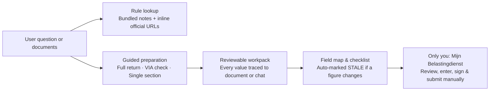

<div align="center">


# NL Tax Agent Skills

**Source-cited Dutch tax answers and step-by-step workpacks<br />for manual entry in Mijn Belastingdienst.**

For employees, homeowners, ZZP'ers and freelancers.<br />
Works in **Claude**, **Claude Code**, **Codex**, **ChatGPT**, **Antigravity**, and other agents via the `skills` CLI.

[](https://github.com/cyanxxy/nl-tax-agent-skills/releases)
[](LICENSE)
[](#saving--privacy)
[](#saving--privacy)

[Two ways to use it](#two-ways-to-use-it) · [What's covered](#whats-covered) · [Install](#install) · [Try it](#try-it) · [Saving & privacy](#saving--privacy)

</div>

---

> [!IMPORTANT]
> **Preparation aid, not tax advice.** The assistant organizes your facts, cites official Dutch rules, and maps values to Mijn Belastingdienst fields. **You** review, enter, sign, and submit everything yourself—the plugin never logs in, operates a browser, or files on your behalf.

## Two ways to use it

<table>
<tr>
<td width="50%" valign="top">

### 1. Ask Dutch tax questions
*Fast, read-only knowledge source*

- Answers 2025 & 2026 rule questions from bundled Belastingdienst & Wet IB 2001 notes with **inline official links**.
- Supports **side-by-side 2025 vs. 2026 comparisons** with every figure tied to its exact year and workflow.
- Zero intake screening, zero personal data collected, **zero files written**.

</td>
<td width="50%" valign="top">

### 2. Step-by-step return helper
*Guided preparation at the depth you want*

- **Full workpack:** reads your *jaaropgaaf*, mortgage, bank, or ZZP statements and builds a complete source-traced workpack + field map + optional manual-entry checklist.
- **VIA verify-and-complete:** already have your *Vooringevulde Aangifte* open? Verify pre-filled figures against source statements and focus on the un-prefilled gaps.
- **Focused section:** walk through just one topic (e.g., Box 3 actual vs. forfaitair, or eigen woning) without a full-return interview.

</td>
</tr>
</table>

## How it works



- **Asks only what's missing.** Credits everything already in your message or attached documents—never assumes zero for a missing figure.
- **Shows every step of its math.** Multi-step calculations (Box 3 truncation, eigen woning + Hillen, ZZP profit chain, partner splits) print intermediate lines and reconciliation checks.
- **Protects against stale numbers.** Correct any figure after generation and the field map and checklist are immediately marked **STALE** until regenerated, so outdated amounts never reach the portal.
- **Nothing written until you say yes.** Everything stays in the conversation unless you opt in to keeping one readable Markdown workpack per workflow.

## What's covered

| Status | Workflow | Tax year | Output |
|:---:|---|:---:|---|
| ✅ | **Annual income-tax return (*aangifte IB*)**<br/><sub>Box 1 (wages, eigen woning), Box 2, Box 3, deductions, credits, fiscal-partner allocation</sub> | `2025` | Workpack + field map + checklist |
| ✅ | **Winst uit onderneming (*eenmanszaak / ZZP*)**<br/><sub>Ondernemer test, urencriterium, KIA, zelfstandigen-/startersaftrek, MKB-winstvrijstelling, Zvw reminder; ROW fallback</sub> | `2025` | Workpack + field map + checklist |
| ✅ | **Voorlopige aanslag**<br/><sub>Request, change (full re-entry), review, or stopzetten (refunds only), incl. expected ZZP profit</sub> | `2026` | Workpack + field map + checklist |
| ✅ | **Dutch tax rule questions**<br/><sub>Reviewed rules + draft topics (clearly flagged as awaiting human review)</sub> | `2025` · `2026` | Sourced answer with official links |
| 🧪 | **btw-aangifte & suppletie**<br/><sub>Sales/purchase reconciliation, reverse charge, KOR screening, private use, pro-rata, herziening, BUA, margin</sub> | `2025` · `2026` | Draft workpack + field map *(blockers only)* |
| 🧪 | **Opgaaf ICP & OSS / IOSS**<br/><sub>Separate per-period / per-scheme drafts; customer VAT IDs kept as aliases</sub> | `2025` · `2026` | Draft workpack + field map *(blockers only)* |
| 🧪 | **M-biljet & C-biljet**<br/><sub>Migration year (emigration/immigration) and nonresident returns</sub> | `2025` *(2026 evidence)* | Draft workpack *(blockers only)* |
| 🧪 | **Annual return 2026 (pre-collection)**<br/><sub>Gather actual YTD evidence separately from provisional forecasts</sub> | `2026` | Draft workpack *(blockers only)* |
| ⛔ | **Out of scope:** VOF / maatschap / CV, BV / DGA profit, staking, agrarisch, zeevarenden, deceased (*F-biljet*), tax year `2027` | — | Routed to manual review / blocked |

<sub>✅ **Reviewed** — sources reviewed; full workpack, field map, and optional manual-entry checklist. &nbsp;·&nbsp; 🧪 **Draft preview** — sources still await human tax review; never labeled filing-ready and checklists list blockers only.</sub>

> [!NOTE]
> **Box 3 & fiscal partners:** For the 2025 annual return, the workpack can compare *forfaitair* and *werkelijk rendement* side by side for your review—the Belastingdienst runs the binding comparison automatically. The 2026 *voorlopige aanslag* uses the *forfaitair* method only. Partner allocation splits are always shown neutrally; you and your partner choose.

## Install

> [!TIP]
> **Install the complete plugin (all 13 skills together).** Every workflow reads shared tax notes and internal domain helpers from `nl-tax-shared-resources`, so copying a single skill folder on its own will not work. No Python, Node runtime, shell commands, or external servers are required at runtime—the plugin is pure Markdown and YAML.

<table>
<tr>
<th width="26%">Host</th>
<th>Install steps</th>
</tr>
<tr>
<td><b>Claude</b><br/><sub>desktop app recommended</sub></td>
<td>

In the Claude app or on claude.ai: **Plugins** *(older apps: Customize → Plugins)* **→ Add → Add marketplace → Add from a repository**, enter `cyanxxy/nl-tax-agent-skills`, and click **Install**.
The plugin syncs to your account (including Claude Code). Use the **desktop app** when you want Claude to work in a local folder and run the read-only specialist reviewer.

</td>
</tr>
<tr>
<td><b>Claude Code</b></td>
<td>

```text
/plugin marketplace add cyanxxy/nl-tax-agent-skills
/plugin install nl-tax-agent-skills@nl-tax-agent-skills-marketplace
```

</td>
</tr>
<tr>
<td><b>Codex CLI</b></td>
<td>

```bash
codex plugin marketplace add cyanxxy/nl-tax-agent-skills --ref main
codex plugin add nl-tax-agent-skills@nl-tax-agent-skills-local
```

Then start a new session.

</td>
</tr>
<tr>
<td><b>ChatGPT</b></td>
<td>

Coming to the ChatGPT Plugins Directory. Once listed, open **Plugins**, install **NL Tax Agent Skills**, and start a new chat (Chat or Work).

</td>
</tr>
<tr>
<td><b>Antigravity & other agents</b><br/><sub>Antigravity, Cursor, GitHub Copilot, OpenCode…</sub></td>
<td>

Install every skill together using the open [`skills` CLI](https://github.com/vercel-labs/skills) (Node.js 22.20+):

```bash
npx skills add cyanxxy/nl-tax-agent-skills --skill '*'
```

Start in plain language or with `nl-tax-intake` / `nl-tax-knowledge`. These hosts also list the internal `nl-tax-shared-resources` bundle in the skill picker, and omit the Claude-only specialist reviewer; all workflows run cleanly inline without it.

</td>
</tr>
</table>

<details>
<summary><b>Organizations, workspaces, or manual ZIP upload</b></summary>

<br />

- **Claude organization:** Mirror this repo privately, then go to **Organization settings → Plugins & skills → Add → Sync from GitHub**, install the Claude GitHub App on the mirror, and keep **Sync automatically** enabled. Pull upstream releases in via reviewed PRs.
- **ChatGPT workspace:** Admins can import this repository under **Admin → Plugins → Add → Import marketplace**.
- **ZIP upload (Claude):** Build a clean archive of tracked plugin files and upload under **Plugins → Add → Upload plugin**:

  ```bash
  git archive --format=zip -o nl-tax-agent-skills.plugin.zip HEAD:plugins/nl-tax-agent-skills
  ```

</details>

## Try it

Just ask in plain Dutch or English—attach your documents whenever you're ready:

| Goal | Example prompt |
|---|---|
| **Rule question** | `How did the Box 3 heffingsvrij vermogen and banktegoeden rate change between 2025 and the 2026 voorlopige aanslag?` |
| **VIA / single-section check** | `I have my pre-filled 2025 VIA open in Mijn Belastingdienst. Help me verify just my eigen woning (WOZ, mortgage interest, erfpacht) and check if tariefsaanpassing applies.` |
| **Full 2025 annual return** | `Help me prepare my 2025 Dutch income-tax workpack. I have my jaaropgaaf, mortgage statement, and bank overview attached.` |
| **2026 voorlopige aanslag** | `Help me change my 2026 voorlopige aanslag after a salary raise. Ask me for the full dataset estimates you need.` |
| **Both workflows together** | `Prepare my 2025 annual return and then help me request a 2026 voorlopige aanslag.` *(Annual finishes first; 2025 and 2026 facts stay strictly isolated.)* |
| **ZZP VAT draft** | `Prepare a draft btw-aangifte for Q3 2026 from my sales and purchase ledgers.` |

<details>
<summary><b>Explicit slash commands (optional)</b></summary>

<br />

Plain language works on every host. When you want to target a specific skill directly (Claude Code `/nl-tax-agent-skills:<name>`, Codex `$<name>`, ChatGPT `@`):

| Skill | Arguments (optional) | Purpose |
|---|---|---|
| `nl-tax-intake` | `annual`, `international`, `request`, `change`, `review`, `stopzetten`, `vat`, `vat-correction`, `icp`, `oss` | Scope screening & routing |
| `nl-tax-knowledge` | your question | Read-only rule lookup (writes nothing) |
| `nl-tax-annual-return` | `2025`, `confirm` | Annual return 2025 (full, VIA check, or focused section) |
| `nl-tax-provisional-assessment` | `2026`, `request`, `change`, `review`, `stopzetten`, `confirm` | Voorlopige aanslag 2026 |
| `nl-tax-annual-return-2026` | `2026` | Annual return 2026 evidence collection *(draft)* |
| `nl-tax-international-return` | `M` or `C`, `2025` or `2026` | M-biljet or C-biljet *(draft)* |
| `nl-tax-vat-return` | year, period (`Q1`–`Q4`, `M01`–`M12`, `Y`) | btw-aangifte *(draft)* |
| `nl-tax-vat-correction` | year, original period | Suppletie / VAT correction *(draft)* |
| `nl-tax-icp` | year, period | Opgaaf ICP *(draft)* |
| `nl-tax-oss` | `union`, `non-union` or `ioss`, year, period | OSS / IOSS return *(draft)* |
| `nl-tax-field-mapper` | workflow, year, period or form | Field map for a confirmed workpack |
| `nl-tax-submit-companion` | workflow, year, identity | Human-only manual-entry checklist |

</details>

## Saving & privacy

- **Zero writes by default.** Nothing is written to disk until you consent (offered at your first progress checkpoint, a pause, or after generation—or anytime you say *"save my workpack"*).
- **One readable file per workflow.** With consent, the assistant keeps a single Markdown workpack in `workspace/` (separate files per year, VAT/ICP period, OSS scheme, or M/C form) so you can resume in a new session by attaching or keeping the file. Say *"stop saving"* anytime; the plugin never deletes, moves, or modifies your original documents.
- **Strict privacy & portal boundaries.** No backend server, no telemetry, no credentials. The plugin never asks for or stores BSN, IBAN, DigiD, policy/aanslag numbers, or customer VAT IDs, and never opens or interacts with Mijn Belastingdienst. Your AI host processes your chat under its own data terms.

<details>
<summary><b>Saved workpack file paths (only created after consent)</b></summary>

<br />

| Workflow | Path in `workspace/` |
|---|---|
| Annual return 2025 | `nl-tax-annual-2025-workpack.md` |
| Voorlopige aanslag 2026 | `nl-tax-provisional-2026-workpack.md` |
| Annual return 2026 *(draft)* | `nl-tax-annual-2026-workpack.md` |
| VAT return *(draft)* | `nl-tax-vat-<year>-<period>-workpack.md` |
| VAT correction *(draft)* | `nl-tax-vat-correction-<year>-<period>-workpack.md` |
| ICP declaration *(draft)* | `nl-tax-icp-<year>-<period>-workpack.md` |
| OSS / IOSS *(draft)* | `nl-tax-oss-<scheme>-<year>-<period>-workpack.md` |
| M- or C-biljet *(draft)* | `nl-tax-international-<year>-<form>-workpack.md` |

`<period>` is your Belastingdienst-assigned period (`Q1`–`Q4`, `M01`–`M12`, or `Y` for VAT/ICP only); `<scheme>` is `union`, `non_union`, or `ioss`; `<form>` is `migration` or `nonresident`.

</details>

See [PRIVACY.md](PRIVACY.md), [TERMS.md](TERMS.md), and [SECURITY.md](SECURITY.md) for full details.

## Contributing

Spotted a wrong rate, rule, or outdated source? [Open an issue](https://github.com/cyanxxy/nl-tax-agent-skills/issues).
Architecture, validation, evals, and release steps are documented in [CONTRIBUTING.md](CONTRIBUTING.md). To test a local checkout in Claude Code:

```bash
claude --plugin-dir ./plugins/nl-tax-agent-skills
```

---

<div align="center">
<sub><a href="LICENSE">Apache-2.0</a> · Pure Markdown & YAML · Filing is always done by you, in Mijn Belastingdienst</sub>
</div>
