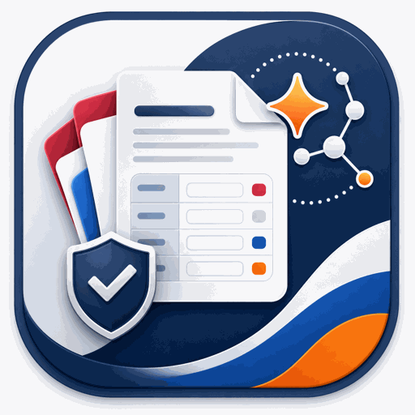
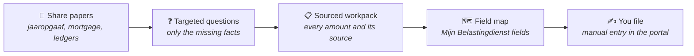

<div align="center">



# NL Tax Agent Skills

<p>
  <strong>Turn scattered Dutch tax paperwork into a reviewable, source-cited workpack for manual Mijn Belastingdienst entry.</strong>
  <br />
  <sub>An Agent Skills plugin for Claude Cowork, ChatGPT Work, Claude Code, and Codex CLI: annual 2025 &amp; voorlopige aanslag 2026, plus draft-only VAT, ICP, OSS, M/C and annual 2026 previews.</sub>
</p>

[](LICENSE)
[](#claude-cowork)
[](#chatgpt-work)
[](#claude-code)
[](#codex-cli)
[](#%EF%B8%8F-supported-workflows)

</div>

---

> [!IMPORTANT]
> **A preparation aid, not tax advice.** The plugin organizes facts, cites
> official rules, and prepares field maps for manual entry. You or an
> authorized person performs every action in **Mijn Belastingdienst** or
> **Mijn Belastingdienst Zakelijk**; the assistant never opens the portal,
> signs, or submits.

## 🎯 What it does

Share your jaaropgaaf, mortgage statement, bank overview, and similar papers,
or just state amounts in the chat. Everything happens in the conversation.



1. **Reads your documents** directly and works out where each amount belongs,
   using source-cited Dutch tax notes for the workflow and year, with their
   review status made clear.
2. **Asks only the missing questions** that matter for your situation.
3. **Builds a workpack** listing every amount, its source, and any open
   questions, so you can check the numbers first. The workpack is generated
   only after you confirm the final review.
4. **Maps supported amounts to their Mijn Belastingdienst fields** for your
   review and manual entry, with an optional checklist. Draft-only workflows
   provide a draft map and a checklist of blockers without amounts. After a
   correction, the assistant marks the affected map and checklist **stale**
   until you regenerate them.

You can also just ask how a rule works, for example “What is the Box 3
heffingsvrij vermogen for 2025?”. The answer comes from the bundled
source-cited notes, names the year and official source, says when a note still
awaits human review, and creates no files.

### How the skills work

Skills are instructions and reference material for the host's AI agent. The
agent selects the relevant skills, reads their supporting notes when needed,
reasons over the evidence, and decides which missing facts to ask for. A clear
VAT, ICP or OSS question goes directly to that topic. The agent asks whether
you mean an annual return or provisional assessment only when a 2026
income-tax request is ambiguous and the distinction changes the answer.

The plugin bundles Markdown/YAML guidance and sources, with no runtime
scripts, hooks or MCP server. Its workflows are agent-driven, not a
deterministic tax engine. Repository validators help maintainers check files,
source metadata and output contracts; behavioral evaluations check agent
responses. Neither replaces human tax-content review or your review of a
workpack.

## 🚀 Quickstart

After [installing](#-install), attach your documents and ask in plain language:

```text
Help me prepare my 2025 Dutch income-tax workpack. I have my jaaropgaaf and mortgage annual overview.
```

```text
Help me request a 2026 voorlopige aanslag. Ask me for the estimates you still need.
```

```text
What is the Box 3 heffingsvrij vermogen for 2025?
```

You can also ask to change, review, or stopzetten an existing 2026 voorlopige
aanslag, or ask for both years in one sentence. The annual workpack is finished
first, then the 2026 flow continues. Each keeps its own facts and sources, and
its own workpack file if you save one.

<details>
<summary><strong>Invoke a skill directly</strong></summary>

```text
/nl-tax-agent-skills:nl-tax-intake annual
/nl-tax-agent-skills:nl-tax-provisional-assessment 2026 request
/nl-tax-agent-skills:nl-tax-vat-return 2026 Q3
```

Replace `request` with `change`, `review`, or `stopzetten`. Syntax varies by
host; the natural-language request above works everywhere.

</details>

## 📦 Install

No shell or Python is needed on any host: the plugin ships no scripts, and
it writes nothing unless you ask it to save your workpack.

### Claude Cowork

Cowork is the primary host for NL Tax Agent Skills.

1. Open Claude Desktop → **Cowork** → **Customize** → **Plugins**.
2. Under **Personal plugins**, select **+** → **Add marketplace** → **Add from a repository**.
3. Enter `https://github.com/cyanxxy/nl-tax-agent-skills` and select **Install**.

### ChatGPT Work

Install **NL Tax Agent Skills** from the ChatGPT Plugin Directory once it is
published, then start a fresh task. On web and mobile, upload files to the
conversation or project; on desktop you can also select a local folder.

### Claude Code

```text
/plugin marketplace add cyanxxy/nl-tax-agent-skills
/plugin install nl-tax-agent-skills@nl-tax-agent-skills-marketplace
```

Or load a checkout for one session:

```bash
claude --plugin-dir ./plugins/nl-tax-agent-skills
```

### Codex CLI

```bash
codex plugin marketplace add cyanxxy/nl-tax-agent-skills --ref main
codex plugin add nl-tax-agent-skills@nl-tax-agent-skills-local
codex plugin list
```

<details>
<summary><strong>Other paths</strong>: Cowork organizations, ZIP upload, unpublished ChatGPT build</summary>

<br />

**Cowork organization.** The organization marketplace accepts only private or
internal repositories. Mirror this repository privately, install the Claude
GitHub App on it, then add it under **Organization settings → Plugins → Add
plugin → GitHub**. Organization auto-sync runs on a merged pull request that
bumps the plugin version, so pull upstream releases in through a PR.

**ZIP upload.** Build a clean archive of the tracked plugin files, then upload
it under **Customize → Plugins → Personal plugins → +**:

```bash
git archive --format=zip -o nl-tax-agent-skills.plugin.zip HEAD:plugins/nl-tax-agent-skills
```

**Unpublished ChatGPT build.** Run `python3 submission/openai/build_bundle.py`
and use `dist/openai/nl-tax-agent-skills.zip` in the workspace's Apps
Management draft flow. This needs publisher verification and Apps Management
write permission.

</details>

## 🗓️ Supported workflows

Rules never carry over between tax years.

### Reviewed and supported

| Workflow | Year | What you receive |
|---|:---:|---|
| Annual income-tax return (aangifte inkomstenbelasting) | **2025** | Workpack covering Box 1, 2 and 3, deductions and fiscal-partner allocation, plus a manual-entry field map |
| Winst uit onderneming (eenmanszaak / ZZP) | **2025** | Belastbare winst from your finalized profit-and-loss statement and balance, carried into the annual workpack |
| Voorlopige aanslag: request | **2026** | Estimate workpack and field map |
| Voorlopige aanslag: change | **2026** | Complete re-entry of every applicable category, not only the changed item, with a change summary |
| Voorlopige aanslag: review | **2026** | Review summary and open questions |
| Voorlopige aanslag: stopzetten | **2026** | Guided checklist for stopping a monthly refund (if you pay monthly and the amount is wrong, the change flow applies instead) |
| Rule questions | **2025 / 2026** | Sourced answer with the note's review status; extended topics remain draft-only; no files created |

Annual 2025 also covers the specific-healthcare-cost threshold, the EUR 925
limited-mobility transport forfait, the legacy DUO prestatiebeurs study-cost
exception, and jaarruimte/reserveringsruimte. For lijfrente limits, the agent
uses the result of the official Belastingdienst Hulpmiddel Lijfrentepremie.

> [!WARNING]
> **Box 3.** Annual 2025 collects inputs for the **fictitious (forfaitair)**
> calculation and, when you supply them, **werkelijk rendement**. The workpack
> shows an informational comparison; supplying actual-return data is
> not a tax-method election, and the official filing environment performs the
> binding comparison and uses the more favorable amount. Provisional 2026 uses the
> **fictitious method only**.

### Draft-only previews

These workflows' official sources still await human tax-content review, so
the assistant never calls a draft complete or ready to file, and a requested
manual-entry checklist lists only the blockers, without amounts.

| Draft workflow | Year / scope | What it prepares |
|---|:---:|---|
| ZZP VAT return (btw-aangifte) — `nl-tax-vat-return` | **2025 / 2026**, one assigned period | Period-specific reconciliation, rubric map, KOR and special-case screening |
| VAT correction or suppletie — `nl-tax-vat-correction` | **2025 / 2026**, one filed period | Comparison of the filed figures against the corrected ones |
| ICP declaration (opgaaf ICP) — `nl-tax-icp` | **2025 / 2026**, one assigned period | Customer aliases and a reconciliation with VAT rubric 3b |
| OSS Union, OSS non-Union, IOSS — `nl-tax-oss` | **2025 / 2026**, one scheme and period | Each country's amounts and corrections kept separate |
| M-biljet (emigration or immigration year) or C-biljet (nonresident) — `nl-tax-international-return` | **2025**; 2026 evidence only | Residence periods, Dutch and foreign income, qualifying-status proof |
| Annual income-tax return 2026 — `nl-tax-annual-return-2026` | **2026** | Separate collection of actual evidence while the year is open; final year-end evidence and the annual form are still pending |

VAT preparation covers an ordinary Netherlands-established eenmanszaak or ZZP
business. Evidenced calculations for private use of a business car, mixed
taxable and exempt use, revision of investment goods and property, BUA, and the
margin scheme go through the read-only `nl-tax-vat-adjustments` helper.
Unresolved KOR transitions, import goods, undecided classifications or
elections, disputed valuations, and missing inputs remain review blockers. ICP
and OSS have their own workflows and files, so no amount is silently merged
into the domestic VAT return. You check and enter your customers' real VAT
identification numbers yourself; the workpack keeps only an alias. VAT, ICP
and OSS returns are filed by you or someone you have authorized (for example
in Mijn Belastingdienst Zakelijk).

The annual 2026 workflow never reuses the 2025 or provisional forms; for an
estimate of 2026, use the voorlopige aanslag. M and C returns record residence
periods, insurance periods and qualifying-status proof; country-specific
treaty questions stay with a human tax professional.

```text
Help me prepare a draft ZZP btw-aangifte for Q3 2026. I use the factuurstelsel and have my sales and purchase ledgers.
```

```text
Prepare my 2025 M-biljet. I emigrated in August 2025.
```

The remaining product gaps and activation reviews are recorded in
[the VAT capability review](docs/maintainers/vat-support-2026-10-02.md) and
[the extended workflow review](docs/maintainers/extended-workflows-2026-10-02.md).

### Not supported

| Case | Year | Outcome |
|---|:---:|---|
| VOF / maatschap / CV, DGA / BV, agrarisch, zeevarenden, staking, deceased person | 2025 | Routed to manual review |
| Any workflow | 2027 | Blocked until 2027 sources are registered and validated |

## 💾 Your workpack file, only if you ask

The plugin writes nothing by default. Tax preparation can take a few sessions,
so the assistant offers to keep your workpack as a file when the workflow
starts, when you pause, and after the workpack is generated, each time as the
only question in its reply. Say yes, or “save my workpack” at any time, and it
keeps **one Markdown file per workflow** (and, for VAT, ICP and OSS, one per
period or scheme) in a `workspace/` folder inside your working folder:

| Workflow | Saved file |
|---|---|
| Annual return 2025 | `workspace/nl-tax-annual-2025-workpack.md` |
| Voorlopige aanslag 2026 | `workspace/nl-tax-provisional-2026-workpack.md` |
| Draft VAT return, 2025/2026 period | `workspace/nl-tax-vat-<year>-<period>-workpack.md` |
| Draft VAT correction of one filed 2025/2026 period | `workspace/nl-tax-vat-correction-<year>-<period>-workpack.md` |
| Draft ICP declaration, 2025/2026 period | `workspace/nl-tax-icp-<year>-<period>-workpack.md` |
| Draft OSS or IOSS return, 2025/2026 | `workspace/nl-tax-oss-<scheme>-<year>-<period>-workpack.md` |
| Draft M (migration) or C (nonresident) return | `workspace/nl-tax-international-<year>-<form>-workpack.md` |
| Draft annual return 2026 | `workspace/nl-tax-annual-2026-workpack.md` |

The period is the filing period the Belastingdienst assigned to you: a quarter
(`Q1`–`Q4`), a month (`M01`–`M12`), or, for VAT and ICP only, `Y` for an
assigned annual filing period. OSS Union and non-Union returns are quarterly
and IOSS returns are monthly; the scheme is `union`, `non_union` or `ioss`.
The form is `migration` or `nonresident`. Each confirmed period has its own
workpack; one quarter never replaces another quarter's file.

The file holds your facts with their sources, the open questions, the field
map, and the manual-entry checklist. It is yours: attach it (or keep it in the
working folder) to continue later, and delete it whenever you like. The plugin
never deletes files, never copies, moves, or renames your documents, and stops
updating the workpack when you say “stop saving”. Consent covers the current
conversation: in a new one, the assistant confirms a saved file before using
it, and asks before replacing an older file rather than merging into it. In a
cloud task whose folder may not outlast the session, you also get the workpack
as a download to keep.
A workpack from an older version (for example a 0.3 `return-pack.md`) is read
as an ordinary source document, not migrated.

## 🧩 Architecture

```text
plugins/nl-tax-agent-skills/
├── .claude-plugin/plugin.json         # Claude manifest
├── .codex-plugin/plugin.json          # Codex manifest
├── agents/
│   └── nl-tax-specialist-reviewer.md  # Read-only specialist reviewer subagent
├── evals/                             # Cowork behavioral eval cases
└── skills/
    ├── nl-tax-shared-resources/       # Runtime contract, knowledge notes, source register
    ├── nl-tax-intake/                 # Entry router and scope screening
    ├── nl-tax-knowledge/              # Read-only rule lookup
    ├── nl-tax-annual-return/          # 2025 annual workpack owner
    ├── nl-tax-provisional-assessment/ # 2026 voorlopige aanslag owner
    ├── nl-tax-field-mapper/           # Sole author of the field map (Appendix B)
    ├── nl-tax-submit-companion/       # Manual-entry checklist
    ├── nl-tax-vat-return/             # Draft VAT return
    ├── nl-tax-vat-correction/         # Draft VAT correction / suppletie
    ├── nl-tax-icp/                    # Draft opgaaf ICP
    ├── nl-tax-oss/                    # Draft OSS / IOSS
    ├── nl-tax-international-return/   # Draft M-biljet / C-biljet
    ├── nl-tax-annual-return-2026/     # Draft annual 2026 evidence collection
    └── …                              # Background helpers: Box 1, Box 2, Box 3, winst, partner, VAT adjustments
```

- **No runtime code.** The installed plugin is Markdown and YAML only: no
  scripts, hooks, or MCP servers.
- **Human-only portal use.** The assistant never logs in to, operates, or
  submits through Mijn Belastingdienst, even when the host could drive a
  browser.
- **Section ownership.** The owning workflow keeps the facts, sources, and open
  questions; the field mapper alone writes `## Field map summary` and
  Appendix B; the submit companion writes `## Manual-entry checklist`.
- **Helpers write nothing.** Intake, knowledge, and the background helpers
  return findings and questions to the owning workflow without touching files.

## 🔒 Privacy

The plugin runs inside your AI host (Cowork, ChatGPT Work, Claude Code, or
Codex), which processes the documents and conversation you share under its own
data terms. The plugin itself sends your data nowhere and fetches nothing by
default; when a workflow calls for a freshness check, the assistant may read
public official pages such as belastingdienst.nl. It stores nothing unless you
ask, and then only the workpack files described above (one per workflow, and
per period or scheme for VAT, ICP and OSS), in plaintext and until you delete
them. It never asks for a BSN, IBAN, or DigiD details, and the workpack never
records a full BSN, IBAN, policy, contract, or aanslag number. In this
repository `workspace/` is git-ignored so taxpayer files are never committed.
See [PRIVACY.md](PRIVACY.md) and [TERMS.md](TERMS.md) for details, and
[SECURITY.md](SECURITY.md) to report an issue.

## 🤝 Contributing

Skill internals, the full validation gate, and the release process are in
[CONTRIBUTING.md](CONTRIBUTING.md). CI runs the gate on every push and pull
request; locally, start with the unit suite:

```bash
python3 -m unittest discover -s tests/nl_tax_agent_skills -p 'test_*.py'
```

Report a suspected wrong rate, rule, or stale source through GitHub Issues.

---

<div align="center">
<sub>
  <a href="LICENSE">Apache-2.0</a>
  &nbsp;·&nbsp;
  Submission is always manual through Mijn Belastingdienst
</sub>
</div>
