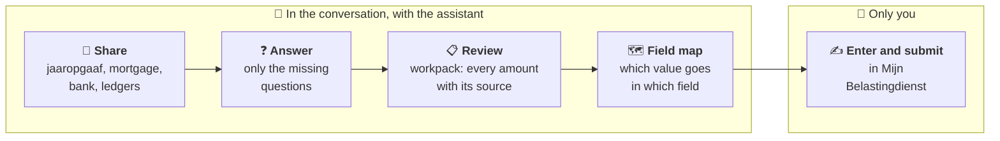

<div align="center">


# NL Tax Agent Skills

**Turn scattered Dutch tax paperwork into a reviewable, source-cited workpack<br />for manual entry in Mijn Belastingdienst.**

For employees, homeowners, ZZP'ers and freelancers.<br />
Runs in Claude, Claude Code, Codex and ChatGPT.

[](https://github.com/cyanxxy/nl-tax-agent-skills/releases)
[](LICENSE)

[Install](#-install) · [What's covered](#-whats-covered) · [Examples](#-try-it) · [Privacy](#-privacy)

</div>

> [!IMPORTANT]
> **A preparation aid, not tax advice.** The assistant organizes your facts,
> cites official rules and maps amounts to portal fields. **You** enter and
> submit everything in Mijn Belastingdienst; the assistant never logs in,
> signs or files.

## ✨ How it works



- **Reads your documents** and works out where each amount belongs, using
  bundled notes that cite the official Dutch rules for that tax year.
- **Asks only what's missing**, nothing that doesn't change the result.
- **Shows its work.** Every amount names its source, and open questions stay
  visible. If you correct something later, the field map is marked **stale**
  until it's regenerated, so an old number never reaches the portal.
- **Answers rule questions** too: *"What is the Box 3 heffingsvrij vermogen for
  2025?"* gets a sourced answer that names the year.

## 📅 What's covered

| Status | Workflow | Year |
|:---:|---|:---:|
| ✅ | **Annual income-tax return**: Box 1 (wages, eigen woning), Box 2, Box 3, deductions, credits, fiscal-partner allocation | 2025 |
| ✅ | **Winst uit onderneming** for an eenmanszaak / ZZP | 2025 |
| ✅ | **Voorlopige aanslag**: request, change, review or stopzetten | 2026 |
| ✅ | **Rule questions** (answers on draft topics say so) | 2025&nbsp;·&nbsp;2026 |
| 🧪 | **btw-aangifte** with KOR screening, and **suppletie** of a filed period | 2025&nbsp;·&nbsp;2026 |
| 🧪 | **Opgaaf ICP** and **OSS / IOSS** returns | 2025&nbsp;·&nbsp;2026 |
| 🧪 | **M-biljet** (emigration/immigration year) and **C-biljet** (nonresident) | 2025<br/><sub>2026 evidence</sub> |
| 🧪 | **Annual return 2026**: evidence collection while the year is still open | 2026 |
| ⛔ | VOF / maatschap / CV, BV / DGA, staking, agrarisch, zeevarenden, deceased person | — |
| ⛔ | Tax year 2027 | — |

✅ **Reviewed**: a full workpack, field map and optional manual-entry checklist.<br />
🧪 **Draft**: the official sources still await human tax review, so drafts are
never called ready to file and the checklist lists only the blockers.<br />
⛔ **Not supported**: routed to manual review, with the facts collected so far
kept for your tax professional. 2027 is blocked until its sources are in.

> [!NOTE]
> **Box 3, 2025:** the workpack can compare the forfaitair method with
> werkelijk rendement for your information. It isn't an election: the
> Belastingdienst runs the binding comparison. The 2026 voorlopige aanslag uses
> the forfaitair method only.

### 💼 For ZZP'ers and freelancers

- **2025 profit, step by step:** ondernemer tests and urencriterium, KIA,
  zelfstandigenaftrek, startersaftrek and MKB-winstvrijstelling to your
  belastbare winst, from your final profit-and-loss statement and balance
  sheet. You're also reminded of the separate Zvw-bijdrage.
- **Not an ondernemer?** Income is prepared as *resultaat uit overige
  werkzaamheden* after a bron-van-inkomen check. Wet DBA is explained, never
  decided for you.
- **2026 voorlopige aanslag** includes your sourced expected profit.
- **btw, ICP and OSS** drafts are kept in separate workpacks per period, so no
  amount is silently merged. Customers' VAT numbers stay aliases; you enter the
  real ones yourself.

## 📦 Install

Install the **whole plugin**. The skills share one knowledge pack, so copying a
single skill folder or uploading it on its own doesn't work.

<table>
<tr><th>Host</th><th>How</th></tr>
<tr><td><b>Claude</b><br/><sub>desktop app recommended</sub></td><td>

In the Claude app or on claude.ai: **Plugins** (older apps: **Customize →
Plugins**) **→ Add → Add marketplace → Add from a repository**, enter `cyanxxy/nl-tax-agent-skills` and select
**Install**. The plugin is saved to your account, so it also appears in Claude
Code. Use it in the **desktop app**, where Claude can work in a folder for your
workpack and run the specialist reviewer. Claude on the web and mobile loads
plugins too, but this one hasn't been verified there yet.

</td></tr>
<tr><td><b>Claude Code</b></td><td>

```text
/plugin marketplace add cyanxxy/nl-tax-agent-skills
/plugin install nl-tax-agent-skills@nl-tax-agent-skills-marketplace
```

</td></tr>
<tr><td><b>Codex CLI</b></td><td>

```bash
codex plugin marketplace add cyanxxy/nl-tax-agent-skills --ref main
codex plugin add nl-tax-agent-skills@nl-tax-agent-skills-local
```

Then start a new session.

</td></tr>
<tr><td><b>ChatGPT</b></td><td>

Coming to the ChatGPT Plugins Directory. Once it's listed, open **Plugins**,
install **NL Tax Agent Skills**, then start a new chat (Chat or Work).

</td></tr>
</table>

No shell, Python or setup is needed: the plugin is Markdown and YAML only.

<details>
<summary><b>For an organization, or from a ZIP</b></summary>

<br />

**Claude organization.** Organization sync accepts only private or internal
repositories. Mirror this repository privately, then under **Organization
settings → Plugins & skills → Add → Sync from GitHub**, install the Claude
GitHub App on the mirror and leave **Sync automatically** on. Every push to the
mirror's default branch reaches your members, so bring in upstream releases
through a reviewed pull request.

**ChatGPT workspace.** An admin can add this repository under **Admin →
Plugins → Add → Import marketplace**.

**ZIP upload (Claude).** Build an archive of the tracked plugin files and
upload it under **Plugins → Add → Upload plugin**:

```bash
git archive --format=zip -o nl-tax-agent-skills.plugin.zip HEAD:plugins/nl-tax-agent-skills
```

</details>

## 💬 Try it

Attach your documents and ask in plain language:

```text
Help me prepare my 2025 Dutch income-tax workpack. I have my jaaropgaaf and mortgage annual overview.
```

```text
Help me request a 2026 voorlopige aanslag. Ask me for the estimates you still need.
```

```text
Prepare a draft btw-aangifte for Q3 2026 from my sales and purchase ledgers.
```

You can ask for both the 2025 return and the 2026 voorlopige aanslag in one
message. The annual return is finished first, and each keeps its own facts.

<details>
<summary><b>Slash commands (Claude Code)</b></summary>

<br />

| Command | Arguments (optional) | Use |
|---|---|---|
| `/nl-tax-agent-skills:nl-tax-intake` | `annual`, `international`, `request`, `change`, `review`, `stopzetten`, `vat`, `vat-correction`, `icp`, `oss` | Not sure where to start |
| `/nl-tax-agent-skills:nl-tax-knowledge` | your question | Rule questions; saves nothing |
| `/nl-tax-agent-skills:nl-tax-annual-return` | `2025`, `confirm` | Annual return 2025 |
| `/nl-tax-agent-skills:nl-tax-provisional-assessment` | `2026`, `request`, `change`, `review`, `stopzetten`, `confirm` | Voorlopige aanslag 2026 |
| `/nl-tax-agent-skills:nl-tax-annual-return-2026` | `2026` | Annual return 2026 evidence (draft) |
| `/nl-tax-agent-skills:nl-tax-international-return` | `M` or `C`, `2025` or `2026` | M- or C-biljet (draft) |
| `/nl-tax-agent-skills:nl-tax-vat-return` | year, period (`Q1`–`Q4`, `M01`–`M12`, `Y`) | btw-aangifte (draft) |
| `/nl-tax-agent-skills:nl-tax-vat-correction` | year, original period | Suppletie (draft) |
| `/nl-tax-agent-skills:nl-tax-icp` | year, period | Opgaaf ICP (draft) |
| `/nl-tax-agent-skills:nl-tax-oss` | `union`, `non-union` or `ioss`, year, period | OSS or IOSS (draft) |
| `/nl-tax-agent-skills:nl-tax-field-mapper` | workflow, year, period or form | Field map for a workpack |
| `/nl-tax-agent-skills:nl-tax-submit-companion` | workflow, year, identity | Manual-entry checklist |

In Codex, type `$nl-tax-intake` and so on; in ChatGPT, type `@` and pick the
plugin or a skill. A plain-language request works on every host.

</details>

## 💾 Saving your workpack

Nothing is written unless you ask. Tax preparation can take a few sessions, so
the assistant offers to save your workpack. Say yes (or *"save my workpack"* at
any time) and it keeps **one readable Markdown file per workflow** in a
`workspace/` folder in your working folder. VAT, ICP and OSS get one file per
period or scheme.

To continue later, attach the file or leave it in the folder. It's yours to
delete whenever you like: the plugin never deletes, moves or renames your
files, and *"stop saving"* stops all updates.

<details>
<summary><b>File names</b></summary>

<br />

| Workflow | File in `workspace/` |
|---|---|
| Annual return 2025 | `nl-tax-annual-2025-workpack.md` |
| Voorlopige aanslag 2026 | `nl-tax-provisional-2026-workpack.md` |
| VAT return | `nl-tax-vat-<year>-<period>-workpack.md` |
| VAT correction | `nl-tax-vat-correction-<year>-<period>-workpack.md` |
| ICP declaration | `nl-tax-icp-<year>-<period>-workpack.md` |
| OSS or IOSS | `nl-tax-oss-<scheme>-<year>-<period>-workpack.md` |
| M- or C-biljet | `nl-tax-international-<year>-<form>-workpack.md` |
| Annual return 2026 | `nl-tax-annual-2026-workpack.md` |

`<period>` is the filing period the Belastingdienst assigned you: `Q1`–`Q4`,
`M01`–`M12`, or `Y` (VAT and ICP only). `<scheme>` is `union`, `non_union` or
`ioss`; `<form>` is `migration` or `nonresident`.

</details>

## 🔒 Privacy

The plugin runs inside your AI host, which processes what you share under the
host's own data terms. The plugin itself has no server, sends your data
nowhere, and only reads public official pages such as belastingdienst.nl when a
freshness check is needed. It never asks for your BSN, IBAN or DigiD details,
and a workpack never records a full BSN, IBAN, policy or aanslag number.

See [PRIVACY.md](PRIVACY.md), [TERMS.md](TERMS.md), and
[SECURITY.md](SECURITY.md) for reporting a vulnerability.

## 🤝 Contributing

Found a wrong rate, rule or stale source?
[Open an issue](https://github.com/cyanxxy/nl-tax-agent-skills/issues).
How the skills are built, validated and released is in
[CONTRIBUTING.md](CONTRIBUTING.md). To try a local checkout:

```bash
claude --plugin-dir ./plugins/nl-tax-agent-skills
```

<div align="center">
<sub><a href="LICENSE">Apache-2.0</a> · Filing is always done by you, in Mijn Belastingdienst</sub>
</div>
